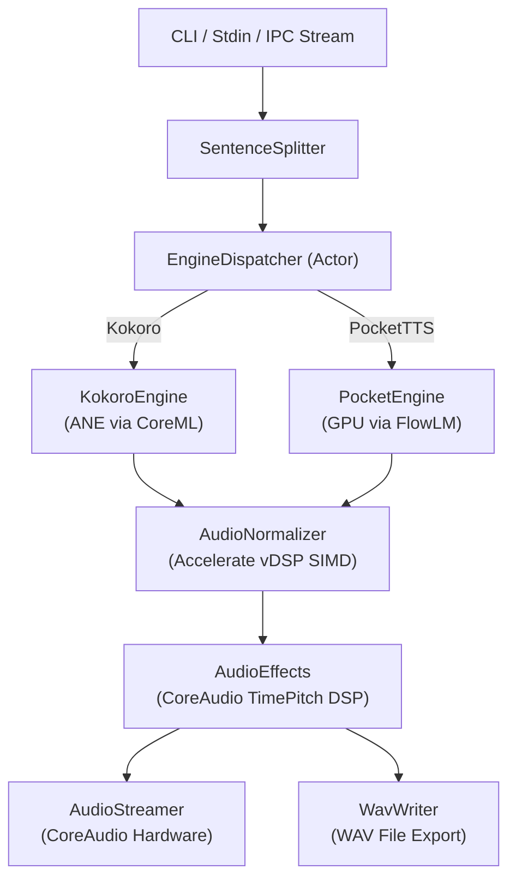

# Architecture & System Design

`sayx` is built from the ground up in Swift to take full advantage of Apple Silicon hardware topology, combining the Apple Neural Engine (ANE), unified GPU, and CPU SIMD vector units into a coherent, low-latency speech runtime.

---

## 1. System Topology

---

## 2. Hardware Acceleration Strategy

### Apple Neural Engine (ANE): Kokoro-82M
- **Engine:** CoreML (`Kokoro-82M`).
- **Target Compute Device:** 16-core Apple Neural Engine (`MLComputeUnits.all` prioritized for ANE).
- **Precision:** 16-bit floating point (`fp16`) quantized tensor weights.
- **Performance Characteristics:**
  - Near-zero host CPU and GPU utilization.
  - Sub-200 ms latency to first audio chunk (Time-to-First-Byte).
  - Generates ~15x faster than real-time on M-series chips.
  - Ideal for continuous text narration, screen reading, and terminal notifications.

### Apple GPU: PocketTTS
- **Engine:** Kyutai Labs FlowLM (flow-matching transformer) and Mimi neural audio codec via `FluidAudio`.
- **Target Compute Device:** Apple Silicon integrated GPU via Metal and MLX runtime.
- **Performance Characteristics:**
  - Expressive prosody with support for arbitrary voice cloning from 3-15 second reference samples.
  - Generates speech faster than real-time on Apple Silicon unified memory architectures.
  - Automatic fallback or routing when user selects PocketTTS cast voices or custom cloned presets.

### CPU SIMD & CoreAudio: DSP & Pacing
- **DSP Engine:** Apple `AVAudioUnitTimePitch` phase-vocoder.
- **Vector Math:** Apple Accelerate framework (`vDSP`) executed on Apple Silicon NEON vector registers.
- **Performance Characteristics:**
  - Sample scaling and loudness analysis executed in microseconds with zero dynamic allocations.
  - Pitch-invariant speed stretching (0.03x to 32.0x) and semitone pitch modulation (-2400 to +2400 cents).

---

## 3. Component Architecture

### EngineDispatcher (`Sources/SayX/Engines/EngineDispatcher.swift`)
A Swift actor that serves as the single point of coordination for text synthesis:
- **Lazy Initialization:** Engines are only instantiated when a voice requiring that engine is requested. If a user only uses Kokoro voices, PocketTTS models are never loaded into memory.
- **Cross-Engine Seamless Switching:** Manages transition boundaries between Kokoro (ANE) and PocketTTS (GPU) during multi-speaker dialogue (`[v:adam] ... [v:alba] ...`).
- **Normalization Invariant:** Enforces SIMD peak normalization (-1.0 dBFS) across all model outputs before emitting audio buffers.

### AudioStreamer (`Sources/SayX/Core/AudioStreamer.swift`)
Coordinates real-time playback through CoreAudio `AVAudioEngine`:
- Maintains a continuous playback buffer queue without re-initializing hardware nodes between sentences.
- Dynamically adjusts playback rate and pitch using `AVAudioUnitTimePitch`.
- Supports synchronized sample capture for session recording (`--tee`).

### SentenceSplitter (`Sources/SayX/Core/SentenceSplitter.swift`)
Splits incoming paragraphs and streaming text lines into natural phonetic chunks:
- Recognizes sentence-ending punctuation (`.`, `!`, `?`, `;`, newlines) while respecting common abbreviations (e.g. `Mr.`, `Dr.`, `e.g.`, `i.e.`).
- Extracts inline speaker directives (`[v:voice_name]`) without corrupting text prosody.

### SocketServer (`Sources/SayX/IPC/SocketServer.swift`)
Provides a non-blocking Unix Domain Socket (`AF_UNIX`) server for IPC:
- Listens on `/tmp/sayx.sock` using BSD socket APIs (`socket`, `bind`, `listen`, `accept`).
- Dispatches client lines asynchronously into the synthesis pipeline.
- Generates JSON telemetry events (`connected`, `sentence_start`, `buffer_update`, `idle`) back to the client.
- Implements bounded queue backpressure when audio buffers exceed threshold (~25 seconds).

---

## 4. Memory Footprint & Concurrency

- **Unified Memory Efficiency:** Shared memory architecture on Apple Silicon allows zero-copy handoffs between CoreML/Metal inference outputs and CoreAudio buffers.
- **Resident Memory:** Under standard Kokoro operation, resident memory usage is bounded to ~350 MB. When both Kokoro and PocketTTS are active simultaneously, memory usage stabilizes at ~500-600 MB.
- **On-Disk Model Cache:** Neural model weights are cached on demand in `~/.cache/fluidaudio/Models/`. See [Model Storage & Offline Operation](models.md) for full directory specifications and cache management.
- **Swift 6 Strict Concurrency:** The entire codebase compiles under Swift 6 concurrency rules:
  - Thread safety enforced via Actors and `Sendable` value types.
  - Clean lifecycle teardown on `SIGINT` (Ctrl+C).
