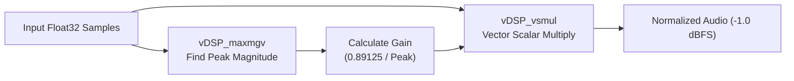

# CoreAudio DSP & Accelerate Normalization

`sayx` uses Apple native system frameworks (**CoreAudio** and **Accelerate**) to handle digital signal processing with zero external dependencies, minimal CPU overhead, and studio-grade fidelity.

---

## 1. CoreAudio Time-Pitch DSP (`AVAudioUnitTimePitch`)

Speech rate and vocal pitch modulation are implemented via Apple's native phase-vocoder DSP unit (`AVAudioUnitTimePitch`).

### Pitch-Invariant Speed Control (`-s, --speed`)

Traditional time-stretching methods that alter sample playback rates introduce the "chipmunk effect" (high pitch when sped up, low pitch when slowed down). `sayx` uses CoreAudio's phase-vocoder engine to decouple playback duration from spectral pitch.

- **Range:** `0.03` to `32.0` (clamped to hardware-supported limits). Default is `1.0`.
- **Granularity:** Continuous floating-point values (e.g. `1.15`, `0.9`, `1.5`).
- **Acoustic Quality:** Preserves formant structures and natural vocal timbres.

```bash
# Speak 25% faster with unchanged vocal pitch
sayx -s 1.25 "Processing complete. All services operational."

# Measured slow delivery for accessibility or transcription
sayx -s 0.85 "Please note down the following verification code."
```

### Pitch Modulation (`--pitch`)

Pitch modulation adjusts vocal register without altering speech speed.

- **Range:** `-2400.0` to `+2400.0` cents (clamped to hardware-supported limits). Default is `0.0`.
- **Units:** Cents (logarithmic pitch measurement):
  - `100 cents` = 1 semitone (half-step)
  - `1200 cents` = 1 octave
  - `+200 cents` = 1 full tone higher (e.g. C to D)
  - `-300 cents` = minor third lower

```bash
# Lower vocal pitch by 2 semitones (-200 cents)
sayx --pitch -200 "Deep resonance mode active."

# Raise vocal pitch by 1.5 semitones (+150 cents)
sayx --pitch 150 "Light, bright vocal register."

# Combine fast delivery with higher pitch
sayx -s 1.2 --pitch 100 "Fast and energetic prompt."
```

### Offline Manual Rendering for Export

When writing synthesized audio to disk (`-o output.wav`), running DSP through standard realtime playback would take the full duration of the speech.

`sayx` configures `AVAudioEngine` into **Offline Manual Rendering Mode** (`enableManualRenderingMode(.offline, ...)`):
- Synthesized PCM samples are piped into an `AVAudioPlayerNode` connected to `AVAudioUnitTimePitch`.
- The engine renders blocks of 4,096 frames in a tight loop directly in RAM.
- **Performance:** Offline rendering completes at **>50x real-time speed** (a 10-second audio track renders in under 200 ms).

---

## 2. Apple Accelerate `vDSP` Vector Normalization

Different TTS models, speakers, and training datasets produce varying output amplitudes. `sayx` runs vector normalization across every audio buffer before playback or file export.

### Peak Normalization (-1.0 dBFS)

To maintain consistent listening levels and protect against DAC (Digital-to-Analog Converter) inter-sample peaks that cause digital clipping and distortion:

$$\text{Target Peak} = 10^{\frac{-1.0}{20}} \approx 0.89125$$

`sayx` applies Apple Silicon SIMD vector instructions via `Accelerate.vDSP`:



- **In-place:** Samples are mutated directly in memory without allocations.
- **Latency:** Takes less than 15 microseconds for a 5-second audio buffer on Apple Silicon.
- **Noise Protection:** If the maximum magnitude is below `1e-4` (pure silence or baseline floor), gain scaling is skipped to avoid amplifying noise.

### RMS Loudness Normalization (-18 dBFS)

For vocal cloning reference audio, `sayx` provides RMS loudness normalization with a peak limiter:

$$\text{Target RMS} = 10^{\frac{-18.0}{20}} \approx 0.12589$$
$$\text{Peak Ceiling} = 10^{\frac{-0.5}{20}} \approx 0.94406$$

1. Computes root-mean-square energy using `vDSP_rmsqv`.
2. Computes peak magnitude using `vDSP_maxmgv`.
3. Scales energy to `-18.0 dBFS`.
4. If scaling would cause any sample to exceed `-0.5 dBFS`, gain is automatically clamped to the peak ceiling to prevent digital clipping.

---

## 3. Reference Audio Pre-Processing Pipeline

When preparing voice reference files for cloning (`sayx voice clone`):

1. **Format Validation:** Reads source file with `AVAudioFile` (supports WAV, MP3, M4A, FLAC, AIFF).
2. **Resampling:** Converts from source sample rate (e.g. 44.1 kHz, 48 kHz stereo) to **24 kHz mono Float32** via `AVAudioConverter`.
3. **SIMD Normalization:** Normalizes amplitude to `-1.0 dBFS`.
4. **Temporary Artifact:** Writes clean 24 kHz WAV to temporary storage for the Mimi neural encoder.
