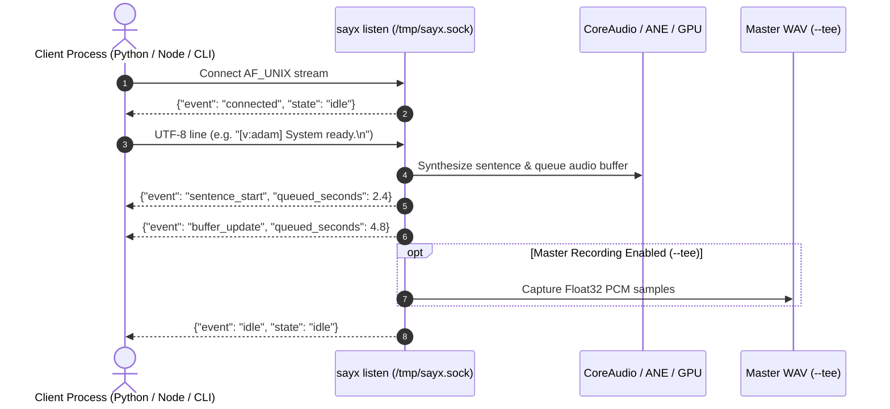

# Unix Domain Socket Daemon & Telemetry

`sayx` includes an integrated Unix Domain Socket (`AF_UNIX`) streaming daemon designed for low-latency IPC (Inter-Process Communication). External tools, editors, background services, and AI agent harnesses can connect to the daemon to stream speech in real time with continuous buffer telemetry.

---

## Architecture Overview



- **Socket Location:** `/tmp/sayx.sock` (configurable via `-s, --socket`).
- **Transport:** Standard Unix stream socket (`SOCK_STREAM`).
- **Input Format:** UTF-8 newline-delimited text (`\n`).
- **Output Format:** UTF-8 newline-delimited JSON telemetry objects (`\n`).
- **Streaming Pipeline:** Text lines are parsed, split into sentences, and synthesized into a continuous CoreAudio output queue without interrupting active playback.

---

## Starting the Daemon

```bash
# Start daemon with default voice (heart)
sayx listen

# Start daemon with custom socket path and default voice
sayx listen --socket /tmp/my_agent.sock -v adam

# Start with custom speed, pitch, and master recording
sayx listen --speed 1.15 --pitch 50 --tee /tmp/session.wav
```

### Options

| Option | Flag | Default | Description |
| :--- | :--- | :--- | :--- |
| `--socket` | `-s` | `/tmp/sayx.sock` | Path to Unix Domain Socket file. |
| `--voice` | `-v` | `heart` | Default voice preset for incoming lines. |
| `--engine` | `-e` | `auto` | Engine selection (`kokoro`, `pocket`). |
| `--tee` | | `nil` | Record all streamed audio to a master WAV file on session completion. |
| `--speed` | | `1.0` | Global playback rate multiplier (0.03x to 32.0x). |
| `--pitch` | | `0.0` | Global pitch shift in cents (-2400 to +2400). |

---

## Communication Protocol

### Client to Daemon (Sending Text)

Send UTF-8 text ending with a newline (`\n`). Each line is split into logical sentence boundaries for fast time-to-first-audio while preserving conversational cadence.

Inline voice tags (`[v:name]`) can be included anywhere in the text:

```text
[v:adam] Hello, agent initialized.\n
[v:bella] Receiving incoming telemetry now.\n
```

### Daemon to Client (Telemetry Events)

The daemon emits real-time JSON objects over the socket so clients can track playback position, schedule follow-up actions, and implement backpressure.

#### 1. `connected`
Sent immediately when a client establishes a socket connection.

```json
{
  "event": "connected",
  "queued_seconds": 0.0,
  "state": "idle"
}
```

#### 2. `sentence_start`
Emitted right before a synthesized sentence begins playback.

```json
{
  "event": "sentence_start",
  "queued_seconds": 3.42,
  "state": "playing",
  "voice": "adam",
  "text": "Hello, agent initialized."
}
```

#### 3. `buffer_update`
Emitted whenever an audio buffer finishes synthesizing and is appended to the CoreAudio hardware queue.

```json
{
  "event": "buffer_update",
  "queued_seconds": 6.85,
  "state": "playing",
  "voice": "adam"
}
```

#### 4. `idle`
Emitted when all queued audio finishes playing and the audio engine transitions back to idle state.

```json
{
  "event": "idle",
  "queued_seconds": 0.0,
  "state": "idle"
}
```

---

## Client Integration Examples

### Bash / Netcat

```bash
# Connect and send a single sentence
echo "System ready." | nc -U /tmp/sayx.sock

# Stream a multi-voice conversation
cat << 'EOF' | nc -U /tmp/sayx.sock
[v:adam] Central access confirmed.
[v:bella] Proceeding to mainframe now.
EOF
```

### Python Client

```python
import socket
import json

def speak_via_daemon(text, socket_path="/tmp/sayx.sock"):
    with socket.socket(socket.AF_UNIX, socket.SOCK_STREAM) as client:
        client.connect(socket_path)
        
        # Send text line
        client.sendall(f"{text}\n".encode("utf-8"))
        
        # Read telemetry
        client_file = client.makefile("r")
        for line in client_file:
            data = json.loads(line)
            print(f"[{data.get('event')}] Queued: {data.get('queued_seconds', 0):.2f}s")
            if data.get("event") == "idle":
                break

speak_via_daemon("[v:adam] Initializing subsystem. [v:bella] Operational.")
```

### Node.js / TypeScript Client

```typescript
import * as net from "net";
import * as readline from "readline";

const client = net.createConnection("/tmp/sayx.sock", () => {
  client.write("[v:adam] Connecting to sayx streaming daemon.\n");
});

const rl = readline.createInterface({ input: client });
rl.on("line", (line) => {
  const event = JSON.parse(line);
  console.log(`Telemetry event: ${event.event}, buffered: ${event.queued_seconds}s`);
  if (event.event === "idle") {
    client.end();
  }
});
```

---

## Flow Control & Backpressure

To prevent unconstrained memory growth during high-throughput text streaming:

- The daemon monitors in-flight CoreAudio buffers.
- When more than **6 buffers** (~25 seconds of synthesized speech) are queued in memory, the daemon pauses reading incoming socket lines until the audio queue drains below the threshold.
- Client socket writes will block naturally once the socket buffer fills, applying OS-level backpressure upstream.
